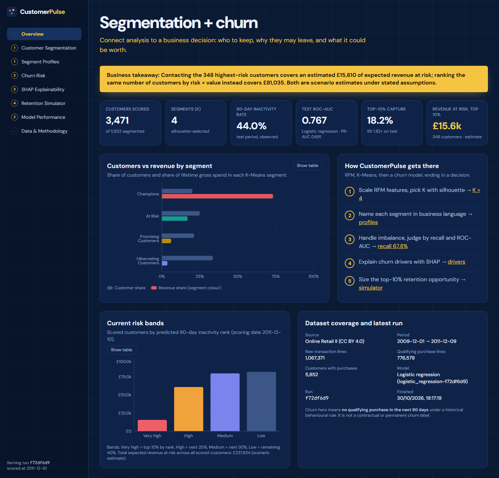
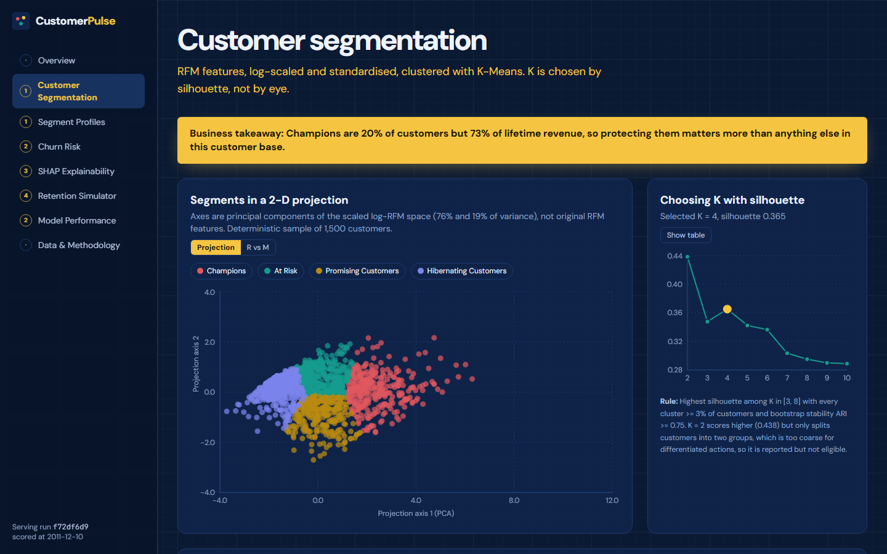
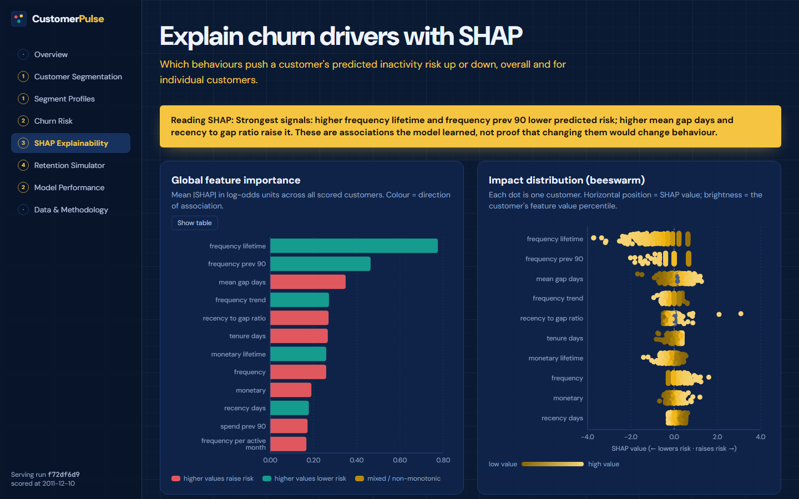
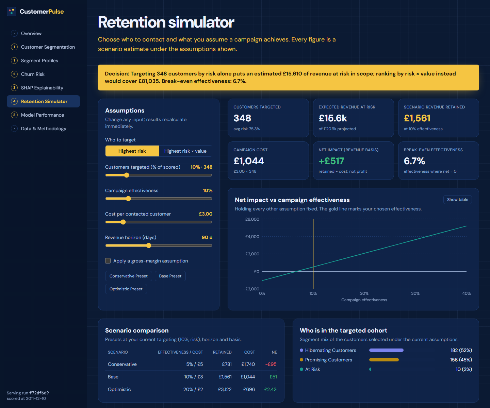
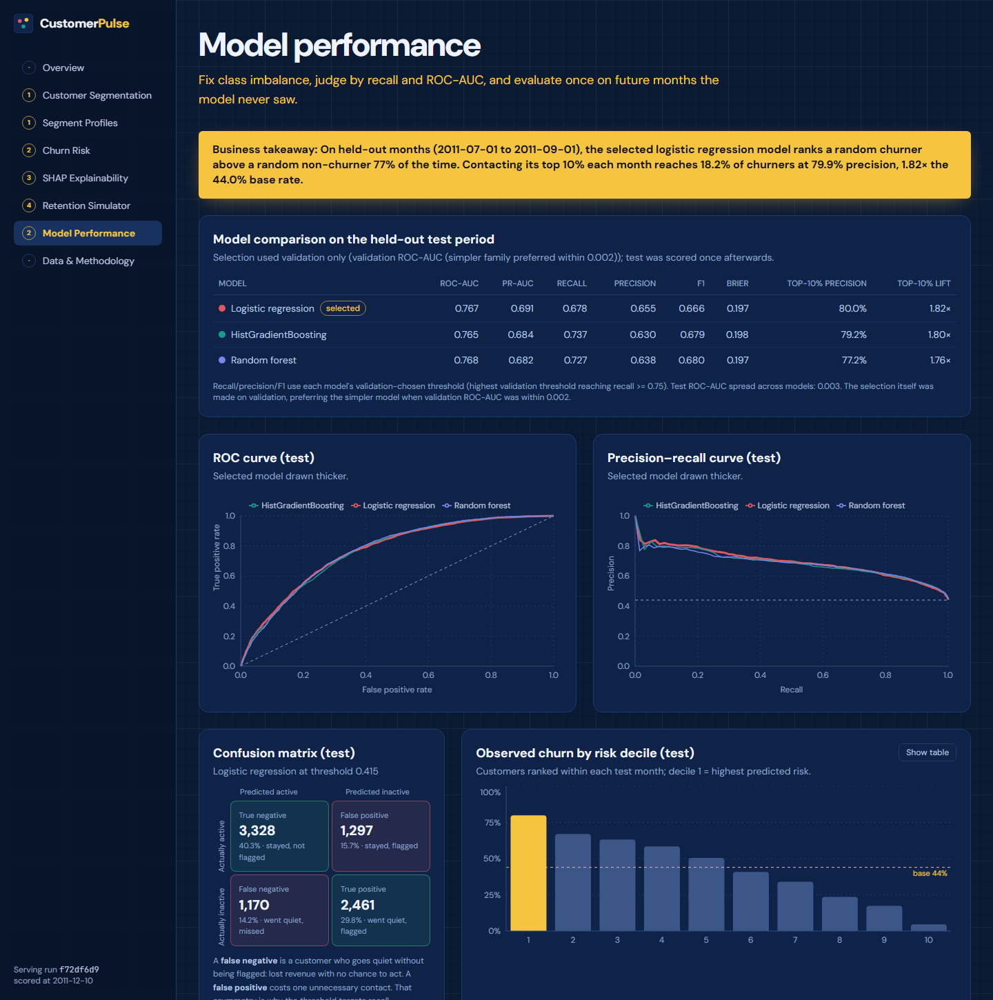
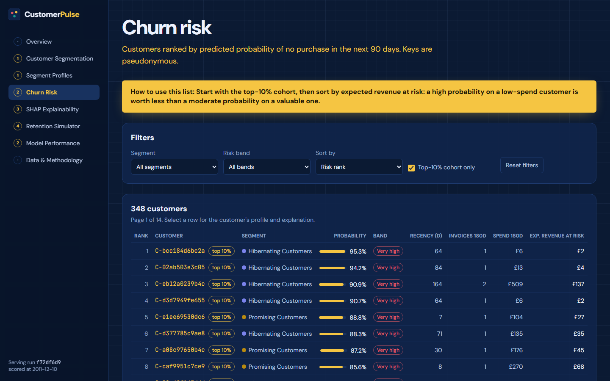
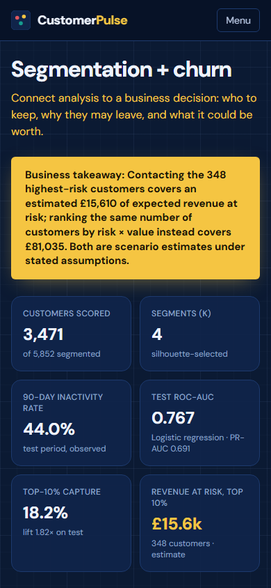
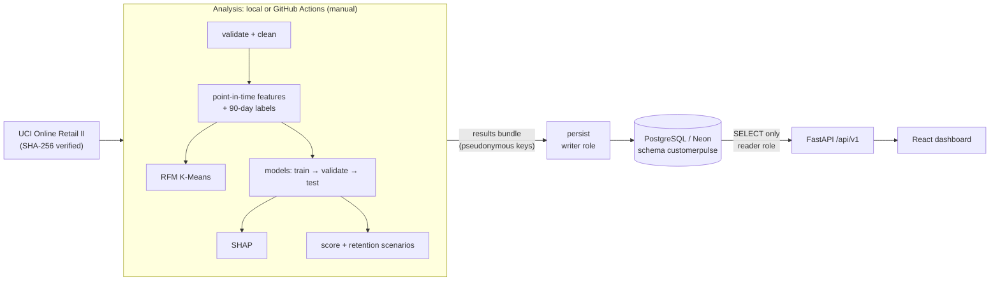

# CustomerPulse: Customer Segmentation & Churn Intelligence

**Connect analysis to a business decision.** CustomerPulse turns two years of
real online-retail transactions into four linked answers:

1. Who the customers are: RFM + K-Means segments.
2. Who is likely to stop buying: a leakage-safe behavioural churn model.
3. Why: SHAP explanations.
4. What contacting the highest-risk 10% could be worth: a retention scenario
   simulator.

It runs end to end: Python pipeline → PostgreSQL → read-only FastAPI → React
dashboard, with tests and CI.

[](https://github.com/parammeet83/customer-segmentation-churn-analytics/actions/workflows/ci.yml)



> **Live demo:** not deployed yet. Deployment to Neon Free and Vercel Hobby is
> fully prepared, but it needs the repository owner to authorise those
> accounts. See [Deployment](#25-deployment). No live URL is claimed until one
> has been verified.

---

## Contents

1. [Project overview](#1-project-overview) · 2. [Problem statement](#2-problem-statement) · 3. [Business objectives](#3-business-objectives) · 4. [Main features](#4-main-features) · 5. [Screenshots](#5-screenshots) · 6. [Architecture](#6-architecture) · 7. [Data flow](#7-data-flow) · 8. [Dataset and attribution](#8-dataset-source-and-attribution) · 9. [Cleaning policy](#9-data-cleaning-policy) · 10. [RFM features](#10-rfm-feature-definitions) · 11. [K-Means and silhouette](#11-k-means-and-silhouette-methodology) · 12. [Churn definition](#12-behavioural-churn-definition) · 13. [Leakage prevention](#13-temporal-leakage-prevention-design) · 14. [Model performance](#14-model-comparison-and-actual-performance) · 15. [SHAP](#15-shap-explainability) · 16. [Retention simulation](#16-retention-simulation-methodology) · 17. [Database](#17-database-design) · 18. [API](#18-api-endpoints) · 19. [Local setup](#19-local-setup) · 20. [Environment variables](#20-environment-variables) · 21. [Migrations](#21-database-migration-commands) · 22. [Analysis commands](#22-analysis-and-training-commands) · 23. [Tests](#23-test-instructions) · 24. [GitHub Actions](#24-github-actions-workflows) · 25. [Deployment](#25-deployment) · 26. [Live links](#26-verified-live-links) · 27. [Results](#27-actual-results-and-data-coverage) · 28. [Limitations](#28-limitations) · 29. [Cost](#29-cost-and-free-tier-notes) · 30. [Resume description](#30-resume-ready-project-description)

---

## 1. Project overview

CustomerPulse is a customer-intelligence platform built on the **UCI Online
Retail II** dataset (1,067,371 transaction lines, Dec 2009 to Dec 2011). It
segments 5,852 customers by RFM behaviour. It predicts which of the 3,471
recently active customers will make no purchase in the next 90 days, and
explains each prediction with SHAP. It then sizes the financial opportunity
of contacting the riskiest customers under assumptions the user controls.

Every number in the dashboard and in this README comes from an executed run.
The run is deterministic: re-running it reproduces the same results exactly.

## 2. Problem statement

A retailer can see that customers stop ordering, but not:

* **which** active customers are drifting away,
* **why** the model thinks so,
* **which segment** they belong to, or
* whether contacting them is **worth the cost**.

Most churn demos stop at a model score, or quietly leak future data into
training. This project builds a defensible label from purchase behaviour,
evaluates it on future months the model never saw, and ends with a decision.

## 3. Business objectives

* Describe the customer base in segments a commercial team can act on.
* Rank active customers by probability of 90-day purchase inactivity.
* Explain risk in plain language, without claiming causality.
* Choose and size a retention cohort (the top 10%) and compare targeting
  strategies.
* Make every assumption visible and adjustable.

## 4. Main features

* **Reproducible pipeline:** official download with a SHA-256 check, Pandera
  validation, and deterministic cleaning with exclusion accounting.
* **Point-in-time features:** 23 behavioural features and monthly labelled
  snapshots.
* **Segmentation:** RFM K-Means with K selected by silhouette, guarded by
  cluster size and bootstrap stability, plus rule-based business names and
  actions.
* **Churn models:** logistic regression, random forest and
  HistGradientBoosting. The final model is selected on validation and tested
  once on held-out months, using a purged chronological split.
* **Metrics:** recall, precision, F1, ROC-AUC, PR-AUC, Brier, calibration,
  confusion matrix and top-decile precision, capture and lift.
* **SHAP:** global ranking, beeswarm and per-customer explanations, with an
  additivity check.
* **Retention simulator:** target %, effectiveness, cost per contact, revenue
  horizon, optional margin, and **risk vs risk × value** ranking.
* **Storage:** PostgreSQL with three least-privilege roles and per-run result
  versioning, so a failed run never replaces good results.
* **API:** read-only FastAPI, with pagination, validation, restricted CORS and
  structured logs.
* **Dashboard:** responsive React dashboard in the navy/gold design language of
  the project reference.
* **Quality:** 95 backend, 19 frontend unit and 39 end-to-end tests; CI with
  lint, type checks, migration round-trip and secret scanning.

## 5. Screenshots

All screenshots are of the actual application running against the actual
analysis results (local stack).

| Customer segmentation | SHAP explainability |
|---|---|
|  |  |

| Retention simulator | Model performance |
|---|---|
|  |  |

| Churn risk (top-10% cohort, pseudonymous keys) | Phone layout |
|---|---|
|  |  |

## 6. Architecture



Details: [docs/ARCHITECTURE.md](docs/ARCHITECTURE.md).

## 7. Data flow

1. `acquire` downloads the official zip (or takes a local archive), verifies
   its checksum and caches the data as Parquet.
2. `validate` → `clean` → `features` → `segment` → `churn` → `score` →
   `explain` → `simulate` → `bundle`.
3. `persist` loads the bundle in one transaction. The run's status moves from
   `running` to `succeeded` or `failed`.
4. The API serves the latest succeeded run; the dashboard renders it.

Raw data and raw customer IDs never leave the git-ignored `data/` folder.

## 8. Dataset source and attribution

> Chen, D. (2012). *Online Retail II* [Dataset]. UCI Machine Learning
> Repository. https://doi.org/10.24432/C5CG6D. Licensed under
> [CC BY 4.0](https://creativecommons.org/licenses/by/4.0/).

These are transactions from one UK-based online gift-ware retailer, many of
whose customers are wholesalers. Two workbook sheets cover 2009-12-01 to
2011-12-09.

The DOI `10.24432/C5BW33`, sometimes quoted for this dataset, belongs to the
older single-year *Online Retail* dataset (UCI #352).

More detail: [docs/DATASET.md](docs/DATASET.md).

## 9. Data-cleaning policy

Every raw row is assigned to exactly one of: purchase, return, or excluded
(with a reason). The pipeline asserts that the totals reconcile.

| Exclusion (priority order) | Rows |
|---|---|
| Duplicate of the 1–9 Dec 2010 sheet overlap (verified identical) | 22,523 |
| Exact duplicate line | 11,812 |
| Missing customer ID | 235,151 |
| Postage, fees, adjustments and test codes | 3,660 |
| Price ≤ 0 | 60 |

**Result:** 776,579 purchase lines, 36,594 invoices, 5,852 customers and
£17.07m gross. In addition, 17,586 cancellation lines (£0.71m) are kept
**separately** as returns.

Purchase frequency never includes refunds, and monetary value is gross
merchandise spend. See [docs/FEATURE_ENGINEERING.md](docs/FEATURE_ENGINEERING.md).

## 10. RFM feature definitions

* **Recency:** days from the last qualifying purchase to the observation date.
* **Frequency:** distinct qualifying **invoices**, never invoice lines.
* **Monetary:** gross qualifying merchandise spend. Returns are a separate
  feature.

The churn model adds point-in-time features:

* average order value, units and distinct products
* active months
* lifetime frequency and spend
* tenure
* mean and spread of the gaps between purchases
* recency relative to the customer's usual gap
* change in spend and order count, last 90 days vs the previous 90
* return value and return rate
* a UK flag

Identifiers are never used as features.

## 11. K-Means and silhouette methodology

* **Features:** `log1p` of lifetime recency, frequency and monetary, then
  `StandardScaler`. Computed for all 5,852 customers at the scoring date.
* **K tested:** 2 to 10.
* **Selection rule:** highest silhouette among K = 3–8, with every cluster
  ≥ 3% of customers and bootstrap stability ARI ≥ 0.75.
* **Selected:** K = 4, silhouette 0.365, stability ARI 0.952.
* **Why not K = 2:** it scores 0.438 but only separates two groups, which is
  too coarse to support different actions.

| Segment | Customers | Revenue share | Median recency | Median invoices | Median spend | Action |
|---|---|---|---|---|---|---|
| Champions | 1,178 (20.1%) | **73.2%** | 16 d | 13 | £4,908 | protect and reward |
| At Risk | 1,459 (24.9%) | 17.0% | 182 d | 5 | £1,457 | prioritise personal win-back |
| Promising Customers | 1,245 (21.3%) | 6.1% | 24 d | 3 | £720 | nurture towards repeat orders |
| Hibernating Customers | 1,970 (33.7%) | 3.7% | 400 d | 1 | £277 | low-cost reactivation only |

Names come from tested rules on each cluster's medians relative to population
tertiles. See [docs/SEGMENTATION_METHODOLOGY.md](docs/SEGMENTATION_METHODOLOGY.md).

## 12. Behavioural churn definition

> A customer who purchased in the **180 days** before a monthly cutoff is
> **inactive (churned = 1)** if they make **no qualifying purchase in the next
> 90 days**.
>
> This predicts future purchase inactivity under a defined historical
> behavioural rule. It does **not** establish that a customer has
> contractually or permanently churned.

The 90-day horizon was chosen because the median gap between purchase days is
60 days and the 75th percentile is 101 days. Mean churn rates for other
horizons: 60 days → 58.8%, **90 days → 50.3%**, 120 days → 44.6%.

## 13. Temporal leakage-prevention design

* **Point-in-time features:** features use only transactions **strictly
  before** each cutoff. Labels use `[cutoff, cutoff + 90 d)`. Snapshots
  without a complete future window are not created.
* **Chronological split with purge gaps:**
  * Train: Jun–Nov 2010, 6 snapshots.
  * Validation: Feb–Apr 2011, 3 snapshots.
  * Test: Jul–Sep 2011, 3 snapshots.
  * Purged: Dec 2010–Jan 2011 and May–Jun 2011, so no label window crosses a
    partition boundary.
* **Preprocessing:** imputation and scaling sit inside the model pipeline and
  are fitted on training rows only.
* **Selection on validation only:** model, hyper-parameters and threshold are
  chosen on validation; test is scored once afterwards.
* **Proof by tests:**
  * A future transaction doesn't change the features.
  * Imputer statistics equal the training medians.
  * Shuffling the test labels leaves the selected model and threshold
    unchanged.
* **Repeated customers:** customers appear in several monthly snapshots
  (4.4 training rows each). Performance on customers never seen before is
  reported separately.

## 14. Model comparison and actual performance

All three models use balanced class weights. The imbalance is mild (45% churn
in training, 38–62% by month), so SMOTE was evaluated and rejected; see
[docs/CHURN_MODELING.md](docs/CHURN_MODELING.md).

**Held-out test (Jul–Sep 2011; 8,256 customer-months; 44.0% inactive):**

| Model | ROC-AUC | PR-AUC | Recall | Precision | F1 | Precision@10% | Lift@10% |
|---|---|---|---|---|---|---|---|
| **Logistic regression (selected)** | **0.767** | **0.691** | **0.678** | **0.655** | **0.666** | **79.9%** | **1.82×** |
| HistGradientBoosting | 0.765 | 0.684 | 0.737 | 0.630 | 0.679 | 79.3% | 1.80× |
| Random forest | 0.768 | 0.682 | 0.727 | 0.638 | 0.680 | 77.5% | 1.76× |

* **Selection:** logistic regression (C = 0.1) had the best validation
  ROC-AUC (0.775). The test results don't change that choice.
* **Operating threshold:** 0.415, the highest validation threshold reaching
  recall ≥ 0.75.
* **Recall drop on test (0.678):** the validation months had a higher,
  seasonal base rate (58% vs 44%).
* **Top-10% targeting:** contacting the top 10% each month reaches **18.2% of
  churners at 79.9% precision**. The ceiling for a 10% contact rate at a 44%
  base rate is about 23%.
* **Decile ranking:** observed churn falls steadily from 79.9% in decile 1 to
  4.6% in decile 10.
* **Customers seen before:** ROC-AUC 0.782.
* **First-time customers:** ROC-AUC 0.692.

More detail: [docs/MODEL_EVALUATION.md](docs/MODEL_EVALUATION.md).

## 15. SHAP explainability

* **Explainer:** `LinearExplainer` on the selected model, with a 500-row
  training background.
* **Additivity:** verified to a maximum error of 1.8 × 10⁻¹⁵.
* **Coverage:** global importance over all 3,471 scored customers, plus local
  explanations for the 348 top-decile customers.

**Strongest drivers:**

* Customers with **more lifetime orders**, **orders in the previous quarter**
  and a **rising order count** are less likely to go quiet.
* **Long typical gaps between orders**, and being **overdue relative to
  their own rhythm**, raise risk.

Correlated features share credit, so read them as groups. These are
associations, **not causes**.

## 16. Retention simulation methodology

```
projected revenue = min(180-day spend / 180, 99.5th-pct cap) × horizon × seasonal factor (0.59)
revenue at risk   = Σ p(inactive) × projected revenue          over the targeted cohort
retained          = revenue at risk × assumed effectiveness
campaign cost     = customers targeted × cost per contact
net impact        = retained × margin − cost                 (margin 1 = revenue basis, not profit)
```

The seasonal factor compares the same calendar windows one year earlier.
December to March is much quieter than June to December.

**Top 10% by risk:** 348 customers with a mean risk of 75.3%, of which 182 are
Hibernating, 156 Promising and 10 At Risk.

| Scenario (assumptions) | Revenue at risk | Retained | Cost | Net (revenue basis) |
|---|---|---|---|---|
| Conservative (5%, £5/contact) | £15,610 | £781 | £1,740 | **−£959** |
| Base (10%, £3/contact) | £15,610 | £1,561 | £1,044 | £517 |
| Optimistic (20%, £2/contact) | £15,610 | £3,122 | £696 | £2,426 |
| **Base, ranked by risk × value** | **£81,035** | £8,104 | £1,044 | **£7,060** |

**The decision:** the riskiest customers are mostly low-spend. Ranking the
same 348 customers by probability × projected value covers **5.2× more
expected revenue at risk**. These are **scenario estimates**: the dataset
contains no campaign or intervention, so **no revenue has been shown to be
saved**. Measuring that would need a controlled experiment.

## 17. Database design

* **Schema:** PostgreSQL schema `customerpulse`, with 13 tables keyed by
  `run_id`. They cover:
  * dataset versions and analysis runs
  * data quality
  * K selection, segments and assignments
  * snapshots and churn scores
  * model metrics and curves
  * SHAP global and local results
  * retention scenarios
* **Constraints:** CHECK constraints (probability, band, status, split),
  foreign keys with cascades, and unique risk ranks.
* **Roles:**
  * `cp_migrator` owns the DDL.
  * `cp_writer` can only change rows.
  * `cp_reader` is SELECT-only, with read-only sessions. Tests confirm it
    can't write even after forcing a read-write transaction.

More detail: [docs/DATABASE_SCHEMA.md](docs/DATABASE_SCHEMA.md).

## 18. API endpoints

Every endpoint is `GET` under `/api/v1`. Interactive docs are at `/api/docs`.

`/health` · `/summary` · `/analysis-runs` · `/data-quality` · `/segments` ·
`/segments/{id}` · `/customers` · `/customers/{customer_key}` ·
`/churn/top-risk` · `/churn/metrics` · `/churn/explanations` ·
`/models/metrics` · `/retention/scenarios` · `/retention/simulator-data` ·
`/retention/simulate`

Parameters are validated and bounded (page size ≤ 100). SQL is
parameterised, errors are safe, CORS allows exact origins only, and there are
no write endpoints. See [docs/API.md](docs/API.md).

## 19. Local setup

Requirements: Python 3.12 with [uv](https://docs.astral.sh/uv/), Node 22+,
and PostgreSQL 17 (or any reachable Postgres).

```bash
git clone https://github.com/parammeet83/customer-segmentation-churn-analytics.git
cd customer-segmentation-churn-analytics
cp .env.example .env                       # fill in values; never commit .env

cd backend && uv sync --extra analysis && cd ..
cd frontend && npm ci && cd ..
```

Optional: an isolated local Postgres cluster just for this project.

```bash
initdb -D .localdb/data -U cp_admin --auth=scram-sha-256 --pwprompt
pg_ctl -D .localdb/data -o "-p 55432" -l .localdb/pg.log start
createdb -h localhost -p 55432 -U cp_admin customerpulse
```

Run the stack:

```bash
cd backend && uv run uvicorn customerpulse.api.app:app --port 8000     # API
cd frontend && npm run dev                                             # http://localhost:5173
```

## 20. Environment variables

See [`.env.example`](.env.example). Real values go only in `.env`, which is
git-ignored, and in provider secret stores.

| Variable | Purpose |
|---|---|
| `CUSTOMERPULSE_PSEUDONYM_SECRET` | HMAC secret for customer keys |
| `ADMIN_DATABASE_URL` | admin connection for `setup-roles` only |
| `MIGRATOR_DATABASE_URL` / `WRITER_DATABASE_URL` / `DATABASE_URL` | migrator, writer and read-only API connections |
| `CP_MIGRATOR_PASSWORD` / `CP_WRITER_PASSWORD` / `CP_READER_PASSWORD` | role passwords applied by `setup-roles` |
| `CORS_ORIGINS` | allowed dashboard origins |
| `CUSTOMERPULSE_TEST_ADMIN_URL` | non-production server for database tests |
| `VITE_API_BASE_URL` | frontend build: public API URL (not a secret) |

## 21. Database migration commands

```bash
cd backend
uv run customerpulse setup-roles     # roles + schema (admin URL, once per database)
uv run alembic upgrade head          # as cp_migrator
uv run alembic check                 # models and migrations agree
```

## 22. Analysis and training commands

```bash
cd backend
uv run customerpulse run-all         # acquire → … → bundle (about 2 minutes)
uv run customerpulse persist         # load the bundle as cp_writer
# individual stages:
uv run customerpulse acquire [--local-archive PATH] | validate | clean | features | segment | churn | score | explain | simulate | bundle
```

Analysis assumptions (windows, K range, guards, threshold rule, scenarios)
live in `backend/src/customerpulse/config.py`. Each run records the config,
the dataset checksum and the git SHA.

## 23. Test instructions

```bash
cd backend  && uv run pytest && uv run ruff check . && uv run mypy
cd frontend && npm run lint && npm run typecheck && npm test && npm run test:e2e
```

Verified results:

* **Backend:** 95 tests passed, 78% coverage.
* **Frontend:** 19 unit and component tests passed.
* **End-to-end:** 39 Playwright tests passed across desktop, tablet and phone.

What each suite covers: [docs/TESTING.md](docs/TESTING.md).

## 24. GitHub Actions workflows

**`CI`** runs on every push, pull request and manual trigger:

* ruff, mypy and pytest against a disposable Postgres 17
* an Alembic upgrade/check/downgrade/upgrade round trip
* an API dependency-footprint check
* frontend lint, type checks, unit tests, build and Playwright tests
* a gitleaks secret scan

It uses read-only permissions, actions pinned by SHA, and no secrets.

**`Analysis (manual)`** is triggered with `workflow_dispatch`:

* reproduces the full analysis from the official archive
* verifies the checksum
* writes a job summary and uploads the aggregate reports
* optionally persists to production, using secrets from the `production`
  environment

There is deliberately no schedule, because the dataset is a fixed historical
extract.

## 25. Deployment

The target is **Neon Free** (database), **Vercel Hobby** (API from
`backend/`, dashboard from `frontend/`) and GitHub Actions. The configuration
is in the repository (`backend/app.py`, `frontend/vercel.json`). Creating the
Neon and Vercel projects needs the owner to sign in.

[docs/DEPLOYMENT.md](docs/DEPLOYMENT.md) has the exact steps, including where
each secret goes, plus the smoke tests.

## 26. Verified live links

None yet. This section will list the dashboard, API and API-docs URLs only
after they pass the production smoke tests.

## 27. Actual results and data coverage

| Item | Value |
|---|---|
| Raw transaction lines | 1,067,371 (2009-12-01 → 2011-12-09) |
| Qualifying purchase lines / invoices | 776,579 / 36,594 |
| Customers segmented | 5,852 |
| Customers scored (active in the last 180 days, scoring date 2011-12-10) | 3,471 |
| Labelled customer-month snapshots | 47,933 (16 months) |
| Segments | 4 (silhouette 0.365) |
| Selected model / test ROC-AUC / PR-AUC / recall | logistic regression / 0.767 / 0.691 / 0.678 |
| Top-10% capture / lift (test) | 18.2% / 1.82× |
| Top-10% cohort / expected revenue at risk | 348 customers / £15,610 (scenario estimate) |
| Same-size cohort ranked by risk × value | £81,035 expected revenue at risk (scenario estimate) |

The aggregate results are in [`reports/results_summary.json`](reports/results_summary.json),
with static figures in [`reports/figures/`](reports/figures).

## 28. Limitations

* **One retailer and one period:** a single UK retailer, 2009–2011, mostly
  business buyers. **Not** representative of current, Indian or global
  consumer behaviour.
* **Missing customers:** about 22% of raw lines have no customer ID.
* **Censored tenure:** tenure starts at December 2009.
* **Inactivity is not loss:** "churn" means purchase inactivity under a fixed
  rule. Seasonal buyers can return.
* **Limited evaluation history:** only one three-month test period remains
  after purging, and the base rate shifts with the season.
* **Production model:** the scoring model is the one trained on the training
  months, chosen so its test metrics apply exactly. Refitting on all months
  is future work.
* **SHAP:** explanations are associations, not causes.
* **Revenue figures:** these are scenarios, not observed savings. They are
  revenue, not profit, unless a margin is set.

## 29. Cost and free-tier notes

The project runs entirely on free tiers:

* **Neon Free:** 1 GB per project, 100 CU-hours per month, scale-to-zero, so
  there is a short cold start after idling.
* **Vercel Hobby:** non-commercial use.
* **GitHub Actions:** free for public repositories.

There are no paid APIs, models, domains or trials, and billing is never
enabled.

## 30. Resume-ready project description

**CustomerPulse: Customer Segmentation & Churn Intelligence** (Python, SQL,
PostgreSQL, FastAPI, React/TypeScript)

* Built a reproducible pipeline over 1.07M UCI Online Retail II transactions:
  checksum-verified ingestion, Pandera validation and deterministic cleaning
  with full exclusion accounting.
* Segmented 5,852 customers with RFM K-Means (log scaling, silhouette-based K
  with size and bootstrap-stability guards) into four rule-named segments.
  Champions are 20% of customers and 73% of revenue.
* Designed a leakage-safe 90-day behavioural churn label over 47,933 monthly
  snapshots, with a purged chronological train/validation/test split. Tests
  prove that no future data, test labels or test-fitted preprocessing affect
  model selection.
* Compared logistic regression, random forest and HistGradientBoosting with
  class weighting. The selected model reached 0.767 ROC-AUC and 0.691 PR-AUC
  on held-out months; its top 10% had 79.9% precision (1.82× lift).
* Explained predictions with SHAP (additivity verified to 1e-15). Built a
  retention simulator showing that ranking by risk × value covers 5.2× more
  expected revenue at risk than risk alone (scenario estimate).
* Shipped a least-privilege PostgreSQL schema (Alembic, three roles), a
  read-only FastAPI service and an 8-page responsive React dashboard.
* Covered the system with 153 automated tests (pytest, Vitest, Playwright) and
  GitHub Actions CI with type checks, migration round-trips and secret
  scanning.

---

*Dataset: Chen, D. (2012), Online Retail II, UCI Machine Learning Repository, used under CC BY 4.0.*
