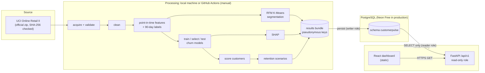

# Architecture

## Overview



### Data flow

1. **Acquire.** The official archive is downloaded once and cached as Parquet,
   with checksums recorded. Raw data never leaves `data/`, which is
   git-ignored.
2. **Analyse.** The deterministic pipeline (seed 42) produces a results bundle
   in `artifacts/latest/`. It holds a manifest JSON plus three Parquet tables,
   keyed by HMAC pseudonymous customer keys.
3. **Persist.** `customerpulse persist` loads the bundle into PostgreSQL in a
   single transaction, using the writer role. The run's status moves from
   `running` to `succeeded` (or `failed`).
4. **Serve.** FastAPI reads the latest succeeded run through the read-only
   role and returns validated JSON.
5. **Present.** The React dashboard calls the API. The retention simulator
   recalculates locally from compact, key-free inputs.

Training and analysis **never** run inside a web request. Vercel serves only
read-only queries.

## Repository layout

```
backend/                     Python 3.12, uv
  app.py                     Vercel entrypoint (imports customerpulse.api.app)
  alembic/                   migrations (schema customerpulse)
  src/customerpulse/
    config.py                all analytical assumptions (windows, seeds, K range, scenarios)
    settings.py              environment-based connection settings (one URL per role)
    ingestion/               acquire (fixed URL, checksum), Pandera validation
    cleaning/                exclusion rules and cleaning report
    features/                point-in-time features, labels, RFM, pseudonymisation
    segmentation/            K-Means, silhouette selection, naming rules
    churn/                   purged temporal split, models, metrics
    explainability/          SHAP (global, beeswarm, local, additivity)
    analytics/               retention projection and scenarios, figures, scenario maths for the API
    database/                ORM models, roles, persistence, sessions
    api/                     FastAPI app, routes, read-only queries
    schemas/                 Pydantic response models
    pipeline.py, cli.py      stage orchestration and `customerpulse` CLI
  tests/                     pytest suites
frontend/                    React 19 + TypeScript + Vite + Tailwind 4 + Recharts
  src/pages/                 8 dashboard pages
  src/components/            layout, design-system primitives, charts
  src/lib/                   API client, types, formatting, scenario maths
  src/test/, e2e/            Vitest and Playwright
reports/                     aggregate results JSON and static figures (committed; no customer data)
docs/                        project documentation
.github/workflows/           CI and manual analysis
```

## Mapping the four analytical stages

| Stage | Pipeline | Tables | Endpoints | Pages |
|---|---|---|---|---|
| RFM + K-Means | `features/rfm.py`, `segmentation/*` | `segments`, `segment_k_selection`, `customer_segments` | `/segments`, `/segments/{id}` | Customer Segmentation, Segment Profiles |
| Behavioural churn | `features/snapshots.py`, `churn/*` | `model_metrics`, `model_curves`, `customer_snapshots`, `churn_scores` | `/churn/metrics`, `/models/metrics`, `/customers`, `/churn/top-risk` | Churn Risk, Model Performance |
| SHAP | `explainability/shap_explain.py` | `shap_global`, `shap_local` (+ beeswarm in run reports) | `/churn/explanations`, `/customers/{key}` | SHAP Explainability |
| Retention (top 10%) | `analytics/retention.py` | `retention_scenarios`, revenue columns of `churn_scores` | `/retention/*` | Retention Simulator, Overview |

## Security architecture

* **Three database roles:**
  * `cp_migrator` owns the DDL.
  * `cp_writer` can only change rows, for persistence.
  * `cp_reader` can only `SELECT`, and its sessions default to read-only. It
    is the only role the public API uses.
* **Secrets:**
  * Stored only in the git-ignored `.env`, in the GitHub `production`
    environment secrets, and in Vercel's encrypted environment variables.
  * The frontend has no secrets; `VITE_API_BASE_URL` is a public URL.
* **Pseudonymous keys:** HMAC-SHA256 with a secret. Raw IDs never reach the
  bundle, the database or the API.
* **API hardening:**
  * GET-only, with bounded pagination and validated parameters.
  * Parameterised SQL and generic error bodies.
  * Exact-origin CORS and `nosniff`.
* **Data download:** only the fixed UCI URL can be downloaded. No
  user-supplied URL is ever fetched.
* **CI:** read-only token permissions, actions pinned by commit SHA, no
  secrets in pull-request jobs, and a gitleaks scan.

## Design system

The dashboard translates the reference image into a product UI:

* **Canvas:** deep navy (`#0b1a33`) with a faint two-scale blueprint grid.
* **Type:** white extra-bold headlines, gold subtitles (`#f5c542`), DM Sans,
  and tabular numerals in tables.
* **Analytical steps:** gold numbered circles, used on the Overview and in the
  navigation.
* **Takeaways:** each page's business takeaway sits in a solid gold banner.
* **Cluster colours:**
  * Red `#e0585e`, teal `#169c8f`, gold `#b88a10` and blue `#7b83ec`, in that
    fixed order.
  * Validated against the navy chart surface for lightness band, chroma,
    colour-vision-deficiency separation (worst adjacent ΔE 9.5) and contrast
    (≥ 3:1).
  * Colour always follows the cluster ID, never its rank.
* **Charts:**
  * Every chart has hover tooltips; multi-series charts have legends or
    direct labels.
  * A "Show table" view is available for key charts.
  * The PCA axes are explicitly labelled as projections.
* **Accessibility:** a skip link, landmarks, labelled form controls,
  `aria-pressed` and `aria-checked` toggles, and a focus-visible gold outline.
  Reduced-motion and forced-colours preferences are respected.

## Key trade-offs

| Decision | Alternative | Why |
|---|---|---|
| Score with the model trained on the training partition | Refit on all labelled months | Test metrics describe exactly the deployed model; refitting is listed as future work |
| No post-hoc calibration | Platt scaling on validation | Validation has a seasonal base rate (58%) that would bias probabilities |
| Segment lifetime RFM of all customers | 180-day RFM of active customers | Lets hibernating customers be described and sized |
| Results tables per run | Overwrite in place | Failed runs never replace good results, and history is auditable |
| Client-side simulator | Server call per slider move | Instant feedback; the API endpoint remains the reference, with parity tests |
