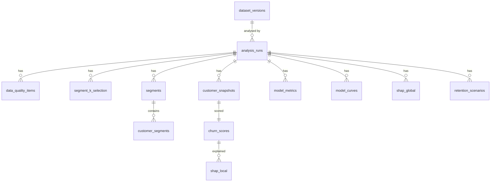

# Database schema

PostgreSQL 17 (local development) and Neon Postgres (production). Models are
in `backend/src/customerpulse/database/models.py`, and the migration is
`backend/alembic/versions/0001_initial_results_schema.py`. All tables live in
the schema **`customerpulse`**, which is owned by the migrator role.

**Design principle:** the database stores *validated analysis results*, not
raw invoices. Raw and intermediate data stay in the processing environment
(`data/`, git-ignored). Every result table is keyed by `run_id`, so several
runs can coexist. The API serves the most recent run with
`status = 'succeeded'`.

## Entity overview



## Tables

| Table | Key | Purpose | Rows (current run) |
|---|---|---|---|
| `dataset_versions` | `id`, unique `zip_sha256` | source, DOI, licence, citation, checksums, raw rows, date coverage | 1 |
| `analysis_runs` | `id` (UUID) | status (`running`/`succeeded`/`failed`, CHECK), timing, git SHA, full config, churn definition, selected K/model/version, scoring cutoff, report JSON, safe error summary | 1 |
| `data_quality_items` | (`run_id`, `reason`) | exclusion counts and shares | 11 |
| `segment_k_selection` | (`run_id`, `k`) | silhouette, inertia, size shares, stability ARI, eligibility, selected | 9 |
| `segments` | (`run_id`, `cluster_id`), unique (`run_id`, `segment_name`) | name, action, size, share (CHECK 0–1), revenue share, levels, medians, means, quartiles, centroid | 4 |
| `customer_segments` | (`run_id`, `customer_key`); FK → `segments` | cluster assignment, PCA coordinates, lifetime RFM, tenure | 5,852 |
| `customer_snapshots` | (`run_id`, `customer_key`) | scoring-date features (RFM columns + all 23 features as JSONB), feature cutoff, feature version | 3,471 |
| `churn_scores` | (`run_id`, `customer_key`); FK → `customer_snapshots`; unique (`run_id`, `risk_rank`) | probability (CHECK 0–1), rank, percentile, band (CHECK), top-decile and threshold flags, projected revenue, expected revenue at risk, model version | 3,471 |
| `model_metrics` | `id`; unique (`run_id`, `model_name`, `evaluation_split`, `config_index`) | validation results for every configuration plus test results for each family's best; confusion counts, top-decile metrics | 14 |
| `model_curves` | (`run_id`, `model_name`, `curve_type`) | ROC / PR / calibration points (JSONB) | 9 |
| `shap_global` | (`run_id`, `feature`) | rank, mean \|SHAP\|, mean SHAP, value-SHAP correlation, direction, description | 23 |
| `shap_local` | (`run_id`, `customer_key`, `feature`); FK → `churn_scores` | top contributions for top-decile customers, with sentences | 2,784 |
| `retention_scenarios` | (`run_id`, `name`) | assumptions and results (JSONB) for the conservative, base, optimistic and value-ranked base scenarios | 4 |

Indexes: `ix_runs_status_finished`, `ix_churn_scores_rank`,
`ix_customer_segments_cluster` and `ix_model_metrics_run_id`, plus the
primary-key and unique indexes. Every child table has `ON DELETE CASCADE` to
`analysis_runs`, so deleting a run removes its results.

## Roles and privileges

Created by `customerpulse setup-roles` (`database/roles.py`) through an admin
connection. Passwords come from environment variables and are never logged.

| Role | Privileges | Used by |
|---|---|---|
| `cp_migrator` | owns schema `customerpulse`; DDL | Alembic (`MIGRATOR_DATABASE_URL`) |
| `cp_writer` | `SELECT, INSERT, UPDATE, DELETE` on tables, sequence usage; **no DDL** | `customerpulse persist` (`WRITER_DATABASE_URL`) |
| `cp_reader` | `SELECT` only; `default_transaction_read_only = on` | public API (`DATABASE_URL`) |

`PUBLIC` loses all database and schema privileges. Default privileges ensure
that tables created by future migrations inherit the same grants.

Verified by tests (`tests/test_db_api.py`):

* `cp_reader` cannot `DELETE`, `UPDATE`, `INSERT`, `CREATE TABLE` or
  `DROP TABLE`, even after `SET TRANSACTION READ WRITE`. The failure is a
  privilege error, not just the read-only default.
* `cp_writer` cannot create tables.
* The `ck_probability` CHECK rejects probabilities outside [0, 1].

## Persistence protocol

1. Insert the `analysis_runs` row with status `running` and commit.
2. Insert all result rows in **one transaction**.
3. On success, set status `succeeded` with `finished_at`, selected K and
   model, and reports.
4. On failure, roll back the results and set status `failed` with a
   truncated, secret-free `error_summary`.
5. The API keeps serving the previous successful run and reports the failed
   attempt.

Re-persisting the same `run_id` is rejected.

## Migration commands

```bash
cd backend
uv run customerpulse setup-roles          # once per database (ADMIN_DATABASE_URL)
uv run alembic upgrade head               # as cp_migrator (MIGRATOR_DATABASE_URL)
uv run alembic check                      # models and migrations agree
uv run customerpulse persist              # as cp_writer (WRITER_DATABASE_URL)
```

CI runs `upgrade → check → downgrade base → upgrade` on a fresh database.
